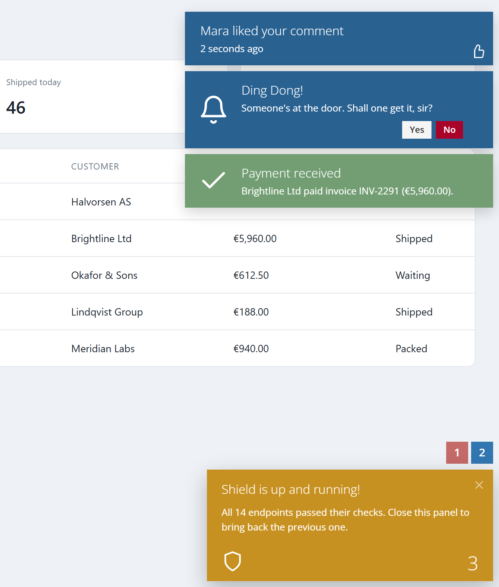
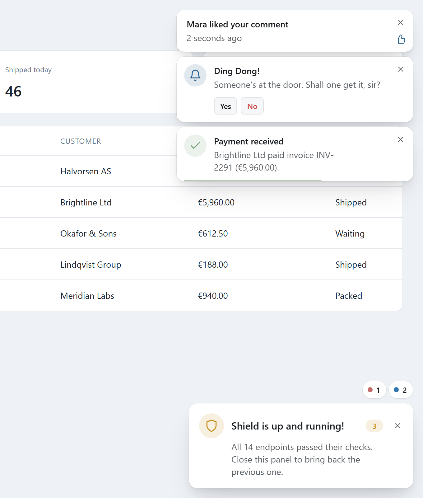
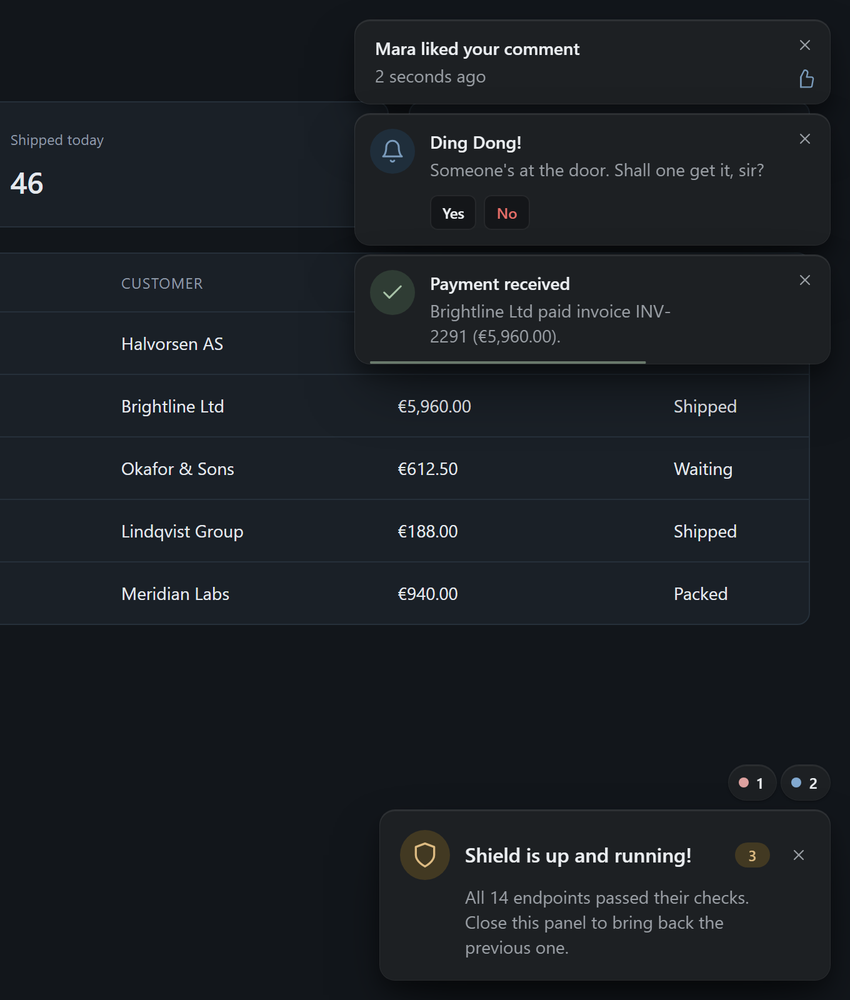
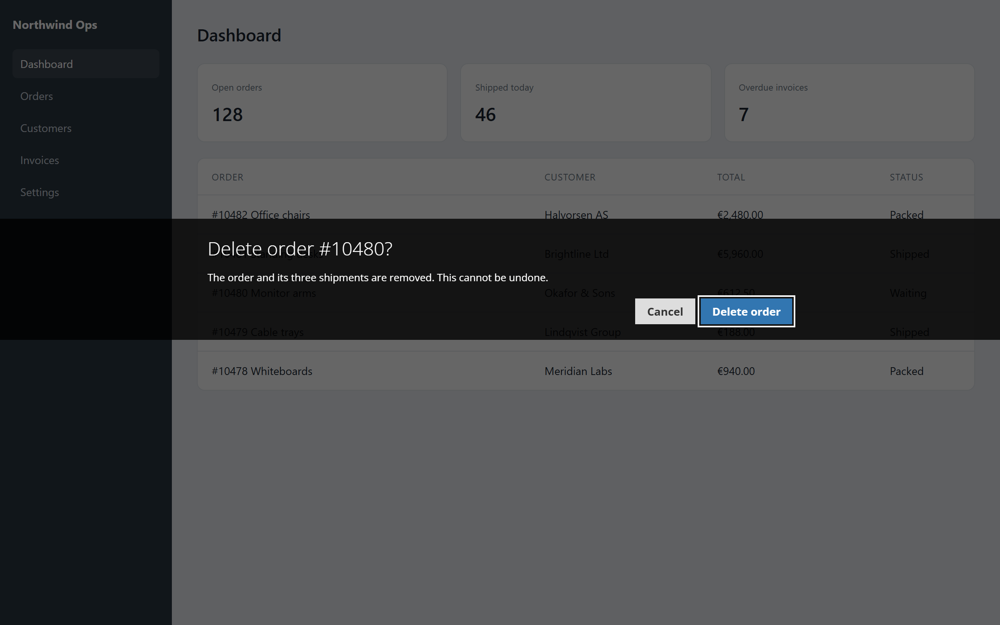
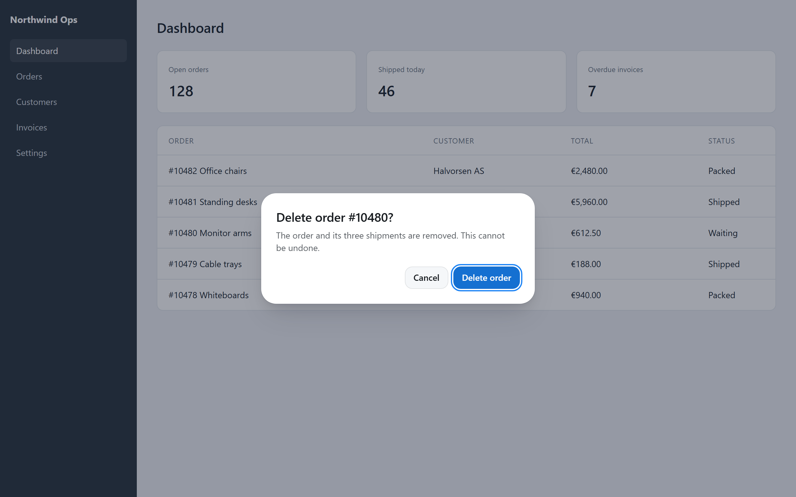
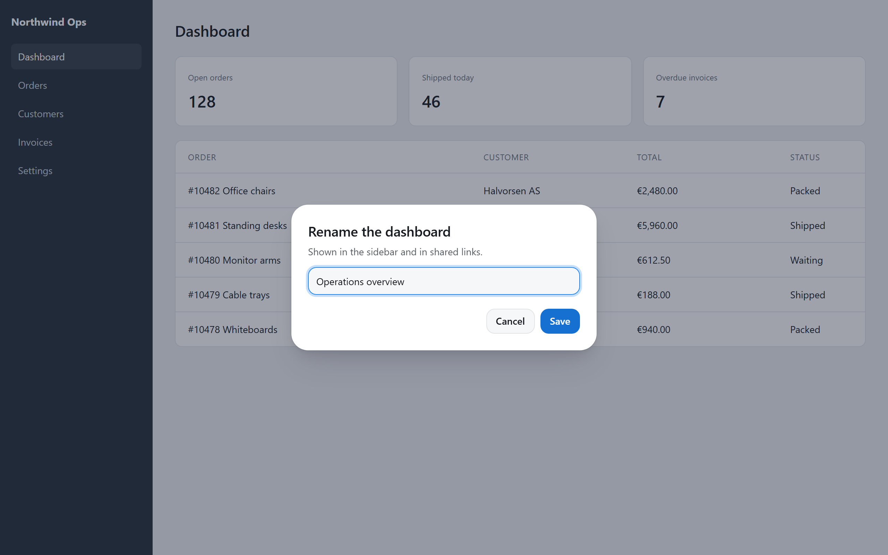
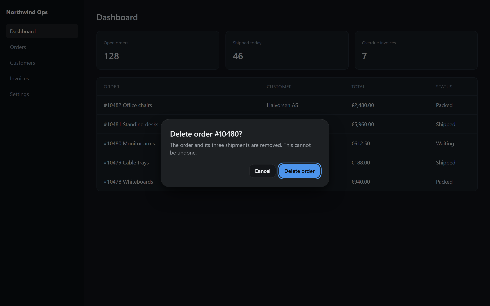

# Herald

Toasts, big notification panels and modal alerts, in two looks: **default**, the classic SmartAdmin notifications people already know, and **polished**, a modern card style with a light and a dark scheme. No dependencies, about 8 KB of JavaScript minified.

Legacy SmartAdmin pages can switch with one script tag: the jQuery build defines `$.smallBox`, `$.bigBox` and `$.SmartMessageBox` with the same options.

| Default | Polished, light | Polished, dark |
|---|---|---|
|  |  |  |

Herald is written from scratch. It reproduces the look and the API of SmartAdmin's notifications but contains none of their code and is not affiliated with SmartAdmin.

## Install

```bash
npm i @ozankurt/herald
```

```js
import Herald from '@ozankurt/herald';
import '@ozankurt/herald/style.css';

Herald.configure({ theme: 'polished' });
Herald.toast({ title: 'Saved', content: 'Your changes are live.', type: 'success', timeout: 4000 });
```

Or with script tags:

```html
<link rel="stylesheet" href="https://cdn.jsdelivr.net/npm/@ozankurt/herald@1/dist/herald.min.css">
<script src="https://cdn.jsdelivr.net/npm/@ozankurt/herald@1/dist/herald.min.js"></script>
<script>
    Herald.toast({ title: 'Hello' });
</script>
```

The default theme uses Open Sans when the page loads it, like SmartAdmin did, and falls back to the system font.

## Toasts

Small boxes stack in the top-right corner, newest on top. Without a `timeout` they stay until clicked. Hovering a toast, or moving keyboard focus into it, pauses its countdown. Toasts and panels are announced to screen readers through a polite live region.

```js
const handle = Herald.toast({
    title: 'Ding Dong!',
    content: "Someone's at the door.",
    icon: 'bell',
    color: '#296191',
    actions: [
        { label: 'Yes', onClick: () => openDoor() },
        { label: 'No', variant: 'danger' },
    ],
});

handle.close();
```

| Option | Description |
|---|---|
| `title` | Bold first line |
| `titleHtml` | Trusted HTML instead of `title` |
| `content` | Text under the title |
| `html` | Trusted HTML instead of `content`. Never pass user input here. |
| `type` | `success`, `error`, `warning` or `info`: sets the colour and icon |
| `color` | Any CSS colour; wins over `type` |
| `icon` | Large icon on the left: a built-in name (`bell`, `warning`, `shield`, `check`, `cross`, `info`, `thumbs`, `cloud`, `clock`) or icon font classes such as `fa fa-bell` |
| `iconSmall` | Small icon in the bottom-right corner, same values as `icon` |
| `timeout` | Milliseconds before it closes; omit it (or pass `0`) to keep the toast open |
| `actions` | Buttons: `{ label, variant?: 'danger', onClick? }`. Clicking one also closes the toast. |
| `closeOnClick` | `false` keeps the toast open when its body is clicked (default `true`); its close button is then always shown |
| `onClose` | Called once, after the toast has gone |

## Panels

Big boxes sit in the bottom-right corner, one at a time. Opening a new panel parks the visible one as a numbered tile above it; clicking a tile brings that panel back, and closing a panel brings back the last parked one.

```js
Herald.panel({
    title: 'Shield is up and running!',
    content: 'All 14 endpoints passed their checks.',
    type: 'warning',
    icon: 'shield',
    number: 3,
});
```

Same options as toasts (`title`, `titleHtml`, `content`, `html`, `type`, `color`, `icon`, `timeout`, `onClose`), plus `number`, shown in the corner and on the parked tile. A `timeout` only runs while the panel is visible and starts again when it is brought back. `Herald.panel()` returns `{ close() }`, which also removes a parked panel.

## Alerts

A modal over a dimmed page. The default theme draws SmartAdmin's full-width band; the polished theme a centred card.

| Default | Polished |
|---|---|
|  |  |

```js
const { button, value } = await Herald.alert({
    title: 'Rename the dashboard',
    content: 'Shown in the sidebar and in shared links.',
    buttons: ['Cancel', 'Save'],
    input: 'text',
    inputValue: 'Operations overview',
});

if (button === 'Save') rename(value);
```

| Option | Description |
|---|---|
| `title`, `titleHtml`, `content`, `html` | As for toasts |
| `buttons` | An array, or SmartAdmin's `'[No][Yes]'` string. The last button is the main action. Default `['OK']`. |
| `input` | `text`, `password` or `select` |
| `inputValue`, `placeholder` | For text inputs |
| `options` | Choices for `select`, as an array or `'[Red][Green]'` |
| `dismissible` | `false` makes Escape do nothing (default `true`) |

It returns a promise of `{ button, value }`. `value` is the input's value, or `null` without an input. Escape dismisses the alert with `button: null`. Enter in a text input presses the main button. Focus moves into the alert, Tab stays inside it, and focus returns to where it was when the alert closes. With several alerts open, only the newest one answers the keyboard. An alert taller than the screen scrolls. A second argument, `(button, value) => {}`, is called too, the way SmartAdmin's callback was; the promise settles first, so a callback that throws cannot leave it pending.

| Polished, with an input | Polished, dark |
|---|---|
|  |  |

## Themes and colour schemes

```js
Herald.configure({ theme: 'polished', scheme: 'auto' });
Herald.settings(); // { theme: 'polished', scheme: 'auto' }
```

- `theme`: `default` (SmartAdmin's look) or `polished`.
- `scheme`: `auto` follows the visitor's system setting, `light` and `dark` force one. Only the polished theme has a dark scheme; the default theme keeps SmartAdmin's colours.

Changing either restyles notifications that are already on screen. Every element Herald adds is a `.hd-root` carrying `data-herald-theme` and `data-herald-scheme`, and each theme is built from `--hd-*` custom properties, so you can adjust one without forking the stylesheet:

```css
.hd-root[data-herald-theme="polished"] {
    --hd-radius-card: 8px;
    --hd-toast-width: 420px;
    --hd-primary: #0f766e;
}
```

Both themes respect `prefers-reduced-motion`: the polished theme drops movement and blur and keeps short fades; the default theme turns its animations off.

The polished theme uses `oklch()` and `color-mix()`, so it needs Chrome or Edge 111, Safari 16.2 or Firefox 113 and later. The default theme has no such requirement.

## Moving from SmartAdmin

Load the jQuery build after jQuery and drop SmartAdmin's `SmartNotification` script:

```html
<link rel="stylesheet" href="https://cdn.jsdelivr.net/npm/@ozankurt/herald@1/dist/herald.min.css">
<script src="https://cdn.jsdelivr.net/npm/@ozankurt/herald@1/dist/herald.jquery.min.js"></script>
```

Existing calls keep working:

```js
$.smallBox({ title: 'Ding Dong!', content: "<i>Someone's</i> at the door", color: '#296191', iconSmall: 'fa fa-bell', timeout: 4000 });
$.bigBox({ title: 'Saved', content: 'All good.', color: '#739E73', icon: 'fa fa-check', number: '4' }, () => console.log('closed'));
$.SmartMessageBox({ title: 'Smart Alert!', content: 'Sure?', buttons: '[No][Yes]' }, (pressed) => console.log(pressed));
```

Differences to know about:

- `title` and `content` are treated as HTML in these three functions, as they were in SmartAdmin. Do not put user input in them.
- `$.SmartMessageBox` ignores Escape, as SmartAdmin did, so its callback only ever receives one of your button labels.
- Font Awesome classes in `icon` and `iconSmall` still render, as long as the page loads Font Awesome. Built-in icon names work without it.
- `sound` is accepted and ignored; Herald plays no sounds.
- The jQuery build also defines `window.Herald`, so new code can use the regular API next to the legacy calls. Load it after jQuery; loaded before, it warns in the console and defines only `window.Herald`.

## Development

```bash
npm install
npm test             # Vitest + happy-dom
npm run build        # dist/, which is committed
npm run examples     # the showcase on http://localhost:5181/showcase.html
npm run screenshots  # recapture docs/images/ from the showcase
```

The showcase takes `?theme=default|polished`, `?scheme=light|dark` and `?scene=notifications|alert|prompt`.

## License

MIT
